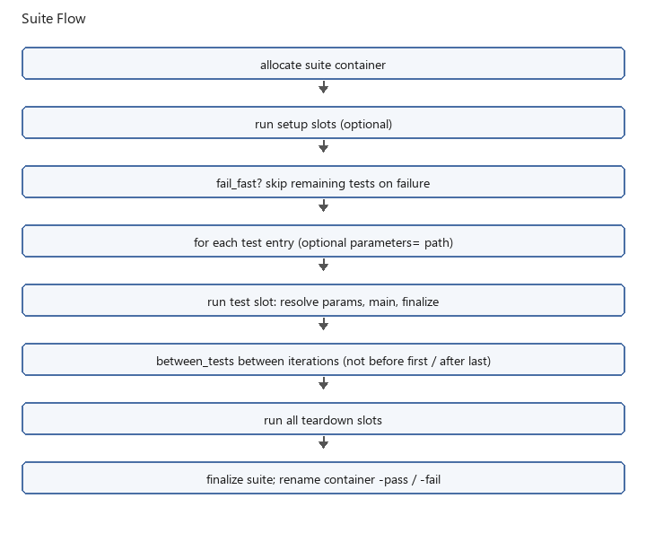

Running suites
==============

Suites are TOML files whose script paths are relative to the suite file::

   name = "smoke"
   setup = ["setup/prepare.py"]
   tests = ["tests/check_device.py"]
   between_tests = ["scripts/delay.py"]
   teardown = ["teardown/cleanup.py"]
   # fail_fast = true   # optional: abort remaining setup/between/test work after any of those fail

Suite pass/fail behavior
------------------------

Suite pass/fail is determined from **test script slots** and from any
session-level ``suite_failed`` mark. Failures in **setup**, ``between_tests``,
or **teardown** always set ``suite_failed`` (the suite overall is FAIL) even
when later work still runs.

``fail_fast`` only controls **scheduling**: with ``fail_fast = false`` (default),
later setup / between / test scripts continue after a failure; with
``fail_fast = true``, remaining setup / between / test work is aborted after
any of those fail. Teardown is always attempted. Inspect supporting-slot
``debug.log`` and ``execution.sqlite`` for details.

Scheduling tests
----------------

Each entry in ``tests`` is either a path string (one run) or an inline table with
``path`` and optional repeat settings:

* ``repeat_count = N``: run the script exactly ``N`` times (``N >= 1``).
* ``repeat_for = "24h"``: run until the duration elapses (always at least one run).
  Use suffixes ``s``, ``m``, ``h``, or ``d`` (for example ``30s``, ``90m``, ``24h``).
  ``repeat_count`` and ``repeat_for`` are mutually exclusive.

Optional suite fields repeat the whole ``tests`` list as one cycle (A, B, C, A, B, C):

* ``cycle_count = N``: run that many full passes (``N >= 1``). Omitted means one pass.
* ``cycle_for = "24h"``: keep starting another full pass until the duration elapses.
  The pass that has already started always finishes, including any per-test repeats.
  ``cycle_count`` and ``cycle_for`` are mutually exclusive and use the same duration
  suffixes as ``repeat_for``.

A per-test ``repeat_count`` or ``repeat_for`` still applies inside each pass. A
``cycle_for`` deadline does not cut short a pass or a test entry's own ``repeat_for``.

Optional ``between_tests`` scripts run **between** test executions, including between
repeat iterations of the same test and between the last test of one cycle and the
first test of the next, but not before the first test or after the final iteration
(teardown follows immediately).

Run a suite with::

   colosseum run-suite suites/smoke.toml --config config/config.toml

Pass ``--metadata config/metadata.yaml`` when test slots should include metadata
identity fields in WATS reports **and** enable WATS with ``--report wats`` (or
``[colosseum.reports] wats = true``). Without WATS enabled, no WATS file is
written.

Suite flow
----------

   Setup and teardown always run (teardown even after fail_fast). Test entries may
   each set ``parameters``; CLI ``--parameters`` still wins for the process.

Parameterized suite example
---------------------------

Same script, two limit files (paths relative to the suite TOML)::

   name = "receiver_limits"

   tests = [
     { path = "receiver_test.py", parameters = "limits_low.toml" },
     { path = "receiver_test.py", parameters = "limits_high.toml" },
   ]

Run::

   colosseum run-suite receiver_suite.toml -g config.toml --report junit

See ``examples/parameters/`` in the core package and :doc:`testware_library` for
copy-out stubs.

Suite CLI options
-----------------

Suites accept the shared path and config flags documented in :doc:`running_tests`
(``-i``, ``-o``, ``-g``, ``-m``, ``-d``, ``--no-artifacts``, ``--dry-run``).
``--dry-run`` walks every slot with the same procedure checks as a single run.
It cannot be combined with ``--mode``, ``-p/--procedure``, or ``--no-artifacts``.
Suites also accept ``-p/--procedure`` or ``--mode procedure``, which run **test**
slots in procedure mode (commands and measurements only; verifications are skipped).
Setup, ``between_tests``, and teardown slots always use full mode. Suites reject
``--mode verify_only`` and ``--use-previous-output`` (those remain single-run only).

Worked example: between two tests
---------------------------------

The suite below runs ``test_a.py``, then ``between.py``, then ``test_b.py``.
``between.py`` does **not** run before the first test or after the last.

**suites/between_two_tests.toml**::

   name = "demo_between_two_tests"

   tests = ["../scripts/test_a.py", "../scripts/test_b.py"]
   between_tests = ["../scripts/between.py"]

A test entry may set ``parameters`` to a TOML path (relative to the suite file).
The same script can appear twice with different files. Setup, between, and
teardown slots do not inherit a test entry's parameters file. CLI
``--parameters`` still wins for the whole process when present.

Each test script can be minimal. The runner provides an output directory through
``get_context().output_dir``:

**scripts/test_a.py**::

   def main() -> None:
       from colosseum.context import get_context

       ctx = get_context()
       path = ctx.output_dir / "invocations.txt"
       with path.open("a", encoding="utf-8") as handle:
           handle.write("test_a\n")

**scripts/between.py**::

   def main() -> None:
       from colosseum.context import get_context

       ctx = get_context()
       path = ctx.output_dir / "invocations.txt"
       with path.open("a", encoding="utf-8") as handle:
           handle.write("between\n")

Execution order: ``test_a`` slot, ``between`` slot, ``test_b`` slot. With
``repeat_count = 3`` on a single test, ``between_tests`` runs between each iteration.

Output layout
-------------

Each suite run creates a **container** directory under ``outputs/``::

   outputs/2026-08-24_180000_boot_soak-pass/
     summary.txt          # roll-up across test slots
     summary.json         # includes provenance once
     debug.log            # provenance block once; not a slot log
     execution.sqlite     # provenance table only
     2026-08-24_180000_prepare/          # setup slot (no -pass/-fail suffix)
     2026-08-24_180001_boot_verify-pass/ # test slot (full artifacts + result suffix)
     2026-08-24_180030_sleep_30s/        # between_tests slot
     2026-08-24_180045_cleanup/          # teardown slot

Every script execution (setup, ``between_tests``, each test iteration, teardown) gets its
own child folder under the container. **Test** slots receive the same artifacts as a
standalone ``colosseum run`` (``debug.log``, ``execution.sqlite``, ``summary.txt``,
``summary.json``, a ``-pass`` / ``-fail`` directory rename, and optional WATS/JUnit
when those listeners are enabled). Supporting slots (setup, ``between_tests``,
teardown) keep a timestamped folder without a result suffix. They write
``debug.log`` and ``execution.sqlite`` only. They do not write ``summary.txt``,
``summary.json``, or report listeners.

The container summary records the suite start time and wall-clock runtime.
Pass/fail counts and percentages cover executed test slots only; setup,
``between_tests``, and teardown stay in the slot list and do not enter those
percentages. When the same test case runs more than once, required verification
failures from those repeats are ranked by count, and the summary keeps the top 10.

During a suite run, ``col.endex()`` finalizes the **current script slot** and returns
control to the runner (it does not exit the process). The runner finalizes each slot
automatically when a script returns without calling ``endex()``.

Each slot finalize closes ``resource_cache`` (calling ``.close()`` on cached
handles). Plugin ``register_shutdown`` hooks run once in ``finalize_suite`` after
all slots, not on per-slot ``endex()``. Scripts that stash live connections in the
cache must reopen them after each slot (or after a mid-suite ``load_config``).

``fail_fast``
-------------

``fail_fast`` controls whether the suite **stops** remaining setup / between /
test work after a failure. It does not change whether supporting-slot failures
count: setup, ``between_tests``, and teardown failures always set
``suite_failed``.

By default (``fail_fast = false``), a failed test or supporting slot does not
prevent later test iterations or teardown; the suite still ends FAIL if any
supporting slot or test slot failed.

Set ``fail_fast = true`` to abort remaining **setup / between / test** work after
any of those slots fail (script exception, non-zero exit, parameters load
failure, slot-start / bookkeeping failure, or required verification/command
FAIL/ERROR). The runner always runs **every** teardown script. Optional
verification failures never trigger fail-fast.

Soak-style suites accumulate failures across repeat iterations; the suite container
summary and exit code reflect whether any test slot failed or ``suite_failed`` was set.

``KeyboardInterrupt`` and other signals keep Python's default behavior; the suite
runner does not turn them into ``SystemExit``.

State between slots
-------------------

All slots execute in one Python process. The runtime context and active
configuration persist; a deliberate reload replaces the shared store. CLI pins
continue to apply. Imported helper modules and their globals also persist;
see :doc:`python_imports`. Each script module is loaded for its execution.

Each slot starts fresh evidence, result aggregation, parameter selection, and
automatic-key state. Finalization closes cached connection handles. Reopen
connections through plugin APIs in later slots; do not keep a cached handle in
a helper global. Shutdown hooks run once after the whole suite.

::

   shared Python process + configuration + helper module globals
       setup slot -> close cached resources
       test slot  -> close cached resources
       between    -> close cached resources
       test slot  -> close cached resources
       teardown   -> close cached resources -> suite shutdown hooks

Use ``try/finally`` inside the test that enables a hardware output. A later
suite teardown is a separate slot; it cannot guarantee immediate cleanup when
that test's measurement raises. Closing a connection does not prove an output
was switched off.

Duration example
----------------

If A takes 40 seconds and B takes 40 seconds, ``cycle_for = "60s"`` starts
one full A/B cycle and finishes it at roughly 80 seconds. It does not interrupt
B at 60 seconds. A single 80-second test with ``repeat_for = "60s"`` also runs
once and finishes at roughly 80 seconds. Durations control whether to start
more work, not a hard interruption deadline.
