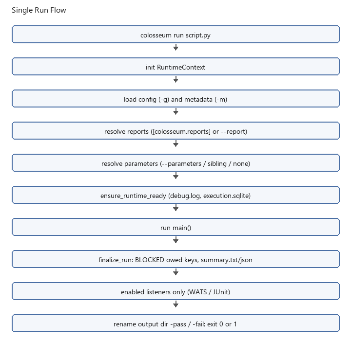
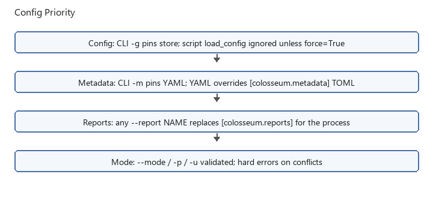

Running test cases
==================

Direct Python execution loads configuration and calls ``col.endex()`` from the script.
The CLI initializes and finalizes the runtime around ``main()``::

   colosseum run my_test.py -g config.toml -m metadata.yaml

The CLI does not execute the script's ``if __name__ == "__main__"`` block.

See :doc:`writing_test_scripts` for a complete script with matching config TOML and
metadata YAML.

Choose an execution mode
------------------------

.. list-table::
   :header-rows: 1

   * - I want to
     - Use
   * - Execute normally
     - ``colosseum run SCRIPT -g CONFIG``
   * - Run without saved artifacts
     - ``--no-artifacts``
   * - Walk a procedure without executing decorated operations
     - ``--dry-run``
   * - Collect measurements and skip verification
     - ``--procedure``
   * - Recheck evidence from a previous run
     - ``--use-previous-output PATH``
   * - Generate per-key parameters
     - ``--export parameters``
   * - Keep the PC from sleeping during a long run
     - ``--no-sleep``
   * - Profile with pyinstrument
     - ``--profile``

Dry run still executes ordinary Python in ``main()``. It is not a sandbox for
subprocess calls, file writes, or other undecorated code.

Single-run flow
---------------

   ``colosseum run`` loads config, resolves reports and parameters, runs
   ``main()``, writes summaries, then calls only enabled report listeners.

Argument priority (summary)
---------------------------

* **Config / metadata:** CLI ``-g`` / ``-m`` pin the store; a later script
  ``load_config`` / ``load_metadata`` is ignored unless ``force=True``. See
  :doc:`configuration`.
* **Reports:** any ``--report NAME`` replaces ``[colosseum.reports]`` for the
  process.
* **Parameters:** ``--parameters`` wins over a suite entry and over sibling
  ``parameters.toml``. See :doc:`using_parameters`.

Output directories
------------------

Normal runs create ``debug.log``, ``execution.sqlite``, ``summary.txt``, and
``summary.json`` beneath ``outputs/<timestamp>_<name>-pass/`` or
``outputs/<timestamp>_<name>-fail/``. Optional WATS
(``wats_<datetime>_<script>.json``) and JUnit (``junit.xml``) files are written
only when those report listeners are enabled (``--report`` or
``[colosseum.reports]``). See :doc:`output_artifacts`.

During execution, before the final result is known, the active directory is named
``outputs/<timestamp>_<name>/``. After ``col.endex()``, the directory is renamed with
``-pass`` or ``-fail``.

Use ``--metadata PATH`` (or ``col.config.load_metadata``) with ``--config`` when
both config TOML and metadata YAML are required.

Use ``--no-artifacts``, ``load_config(..., no_artifacts=True)``, or
``COLOSSEUM_NO_ARTIFACTS=1`` for console logging and in-memory SQLite without files.
Use this for measurement/verification procedures that do not save files.
Plugin commands that need an output directory (screenshots, trace/IQ exports,
host-profile or telemetry captures) raise an error in this mode; they do not
turn into in-memory captures. For a measurement-only example see
:doc:`writing_test_scripts` and run it with ``--no-artifacts``.

Pass ``-d`` or ``--debug`` to include DEBUG messages on stdout. The persisted log always
includes DEBUG messages.

CLI options
-----------

Shared path and config flags for ``colosseum run`` and ``colosseum run-suite``:

- ``-i/--input-dir PATH`` - base directory for the positional script or suite path
  only (joined with the positional argument; pass a basename when using ``-i``)
- ``-o/--output-dir PATH`` - custom output root for timestamped run folders (default:
  ``cwd/outputs``)
- ``-g/--config PATH`` - config TOML (short form ``-g``); resolved from the process
  cwd and not affected by ``-i``
- ``-m/--metadata PATH`` - metadata YAML (short form ``-m``); likewise cwd-relative
- ``-d/--debug`` - include DEBUG logs on stdout
- ``--no-artifacts`` - in-memory SQLite and console logging only
- ``--no-sleep`` - prevent system sleep until the run or suite completes
  (screen may still blank or lock; uses wakepy ``keep.running``)
- ``--profile`` - profile with pyinstrument; write ``profile.html`` under the
  output directory (text only with ``--no-artifacts``)
- ``--dry-run`` - walk each script and log every command, measurement, and
  verification. The default policy logs arguments and does not call the function.
  Omitted measurement keys fail the slot unless the script called
  ``col.auto_key()`` (the ERROR text suggests ``key=`` or ``col.auto_key()``).
  Omitted verification keys are allowed for spot-checks; dry-run records a tip
  instead of failing. The walk checks duplicate measurements, ``multi_row`` row
  indexes, call signatures, and argument types where the function has a type
  hint. Duration and frequency strings are checked after they are parsed. An
  argument with no hint is not checked. A key with no parameters-file section
  keeps the call arguments. Soft tips also cover unused parameters-file
  sections, keyed verifications with no prior measurement in the walk, and an
  empty walk with no decorated calls. Tips appear in ``debug.log`` and under
  **Dry-run tips:** in ``summary.txt``. It records each problem and continues,
  and a required error fails the slot. ``debug.log``, ``summary.txt``, and
  ``summary.json`` are still written. ``run-suite --dry-run`` uses the same
  checks on every slot.
- ``--parameters PATH`` - parameters TOML (limits and per-key kwargs) for this run
- ``--report NAME`` - enable a report listener (``wats``, ``junit``); repeatable.
  When any ``--report`` is present, that set replaces ``[colosseum.reports]``

``colosseum run`` additionally supports:

- ``-c/--command SPEC`` - invoke a plugin ``@command`` (``namespace.function,key=val,...``);
  repeatable; may be used without a script path
- ``-p/--procedure`` - run commands and measurements; skip verifications
- ``-u/--use-previous-output PATH`` - import prior measurements/commands from a completed
  run directory and re-run verifications only (mutually exclusive with ``-p``).
  For Windows quoted paths, see :doc:`troubleshooting`.
- ``--show-faults`` - opt-in ``faulthandler`` crash dumps for this run
- ``--export parameters`` - walk the script, write ``parameters.toml`` in the run
  folder from the keys and keyword values that were passed, and do not run decorated
  functions or score the run. The folder is not renamed ``-pass`` or ``-fail``.

``--dry-run`` and ``--export`` cannot be combined with each other, with
``--mode`` / ``-p`` / ``-u``, or with ``--no-artifacts``. ``--export parameters``
also requires a test file and cannot be combined with ``-c`` or ``--parameters``.

Examples::

   colosseum run my_test.py -i scripts -g config/config.toml -m config/metadata.yaml
   colosseum run -o D:/test_runs -c template.arm_device,device_id=1 -g config/config.toml
   colosseum run scripts/my_test.py -p -g config/config.toml
   colosseum run scripts/my_test.py -u outputs/2026-01-01_120000_my_test-pass -g config/config.toml
   colosseum run scripts/my_test.py -u "D:\runs\prior run" -g config/config.toml
   colosseum run scripts/my_test.py -u "D:/runs/prior run/" -g config/config.toml
   colosseum run scripts/my_test.py --parameters limits.toml --report wats --report junit -g config/config.toml
   colosseum run scripts/my_test.py --dry-run -g config/config.toml
   colosseum run-suite suite.toml --dry-run -g config/config.toml
   colosseum run scripts/my_test.py --export parameters -g config/config.toml

Standalone ``-c`` runs allocate a normal output directory and record command evidence
without executing a test script. Combine ``-c`` with a script path to run plugin commands
and the script in one process and one output directory.

See :doc:`running_suites` for suite-specific flags (including ``-p`` on test slots).

Offline evidence replay
-----------------------

Verification-only execution imports the previous run's measurements and
commands into a new run, skips decorated acquisitions/actions, and reruns
verifiers. New limits do not refresh the measurement or contact the device.

After the passing run in :doc:`quickstart`, create the ``tight.toml`` from
:doc:`using_parameters`, then substitute the actual completed folder below::

   colosseum run my_test.py -g config.toml --parameters tight.toml --use-previous-output outputs/<timestamp>_my_test-pass

The recorded 3.3 is checked against 3.5 +/- 0.05 and fails. The previous run
stays intact; inspect the newly created run folder. Keep the procedure and keys
compatible with the original acquisition. Verifiers that inspect live UI or
files can still need those resources; a database cannot recreate them.
