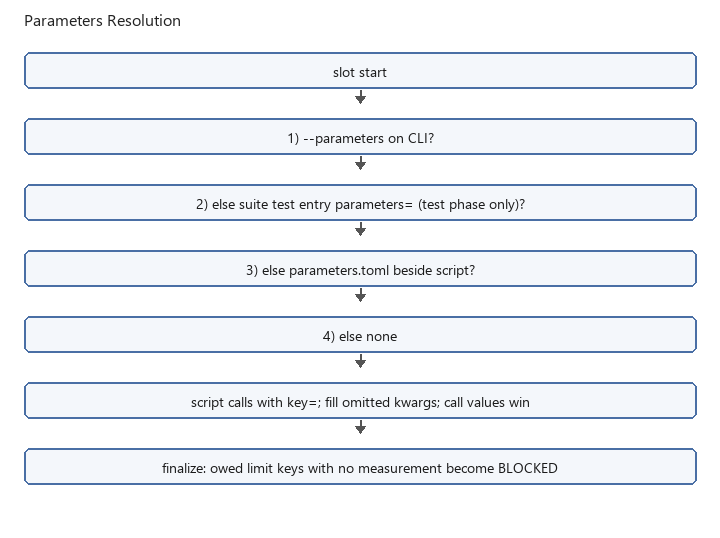

Using parameter files
=====================

An optional TOML parameters file supplies kwargs by evidence key. Tables are
keys; values are keyword arguments for ``@command`` and ``@verification`` calls
that pass ``key=``. A field in the file overrides the same argument on the call.
Arguments the file omits stay as passed.

.. list-table:: Parameter file selection (first match wins)
   :header-rows: 1

   * - Priority
     - File source
   * - 1
     - CLI ``--parameters PATH``
   * - 2
     - Suite test entry's ``parameters`` field
   * - 3
     - ``parameters.toml`` beside the script
   * - 4
     - No parameter file

When a file is loaded, a ``key=`` with no section keeps the arguments from the
call. A section that is present overrides those arguments. A present but invalid
file fails the slot before ``main``. If a run ends before measuring a key with
configured limits, finalization records the corresponding verification as
``BLOCKED``. Sections that contain ``expected_val``,
``expected_result``, ``tolerance``, ``minimum``, ``maximum``, ``exact``, or
``expected`` define those outstanding checks (called *owed limits*).

**Limit-only parameters file** (``parameters.toml``)::

   [dut_3v3_rail]
   expected_val = 3.3
   tolerance = 0.1

   [rx_level]
   expected_val = 0.0
   tolerance = 0.5

**Script** (limits come from the file via ``key=``)::

   def main() -> None:
       measure_level(key="rx_level", value=0.0)
       verify_level(key="rx_level")  # expected_val / tolerance filled from file

**Suite** (same script, two files)::

   name = "receiver_limits"
   tests = [
     { path = "receiver_test.py", parameters = "limits_low.toml" },
     { path = "receiver_test.py", parameters = "limits_high.toml" },
   ]

**Reading one field**

``col.load_parameter(key=..., field=...)`` returns one value from the loaded
parameters file. A procedure uses it for a list of paths or another setting
the script reads itself. Ints, floats, bools, and ordinary strings come back
as written. A TOML array or inline table comes back as a list or dict.
A quoted Python literal is parsed, and so is a bracketed list of bare words.

**captures.toml**::

   [captures]
   files = "[trace.bin, C:/data/other.bin]"
   count = 3

**Script**::

   files = col.load_parameter(key="captures", field="files")
   for path in files:
       measure_capture(path)

``[thing1, thing2]`` becomes a list of strings. ``{1, 2}`` becomes a set and
``{'a': 1}`` becomes a dict. Bare ``true``, ``false``, ``yes``, and ``no``
inside a list become bools. A note such as ``[see manual]`` stays a string.
A quoted number such as ``"99"`` stays a string; unquoted ``99`` is an int.
``key=`` calls receive the value as loaded from TOML.

A missing parameters file, key, or field raises ``ParametersError``. A matched
bracket string that cannot be parsed, such as an empty slot or an unclosed
inner bracket, raises ``ParametersError`` as well. ``{}`` is an empty dict.
An empty set has no literal form.

See ``examples/parameters/`` in the core repository checkout. For ready-made bench procedures,
copy a folder from :doc:`testware_library`.

``colosseum run SCRIPT --export parameters`` walks ``main()`` and writes
``parameters.toml`` in the run folder. Sections are the evidence keys. Values are
the keyword arguments passed on ``@command``, ``@measurement``, and
``@verification`` calls, except ``key`` and ``row_index``. ``key`` is already
the section name. ``row_index`` identifies one row of a multi-row measurement
(together with the domain, command, and key). Export keeps a single section per
key and later calls overwrite earlier fields, so a series would collapse to the
last index. The script chooses the row as it loops. Decorated functions are not
called, and the folder is not renamed with a pass or fail suffix. Variables and
``col.auto_key()`` are evaluated because ``main()`` still runs.

Resolved-value example
----------------------

Install Shared and use the files from :doc:`quickstart`. Create **tight.toml**::

   [voltage]
   expected_val = 3.5
   tolerance = 0.05

Then run::

   colosseum run my_test.py -g config.toml --parameters tight.toml

The measurement remains 3.3. The verifier uses 3.5 +/- 0.05 from the file,
overriding 3.3 +/- 0.1 on the call, and records FAIL. Change only the file's
``tolerance`` to 0.3 and rerun: the check passes. A file that supplies only
``tolerance`` retains the call's ``expected_val``.

.. list-table:: Effective arguments for the same call
   :header-rows: 1

   * - Parameter section
     - Expected value
     - Tolerance
     - Result for 3.3
   * - None
     - 3.3 (call)
     - 0.1 (call)
     - PASS
   * - ``tight.toml``
     - 3.5 (file)
     - 0.05 (file)
     - FAIL
   * - ``tight.toml`` after editing tolerance
     - 3.5 (file)
     - 0.3 (file)
     - PASS

Commands and verifications receive per-key overrides. Measurements are included
in parameter export, but their acquisition arguments are not overridden by
this mechanism. File selection precedence chooses one file; it does not merge
the CLI, suite-entry, and sibling parameter files.
