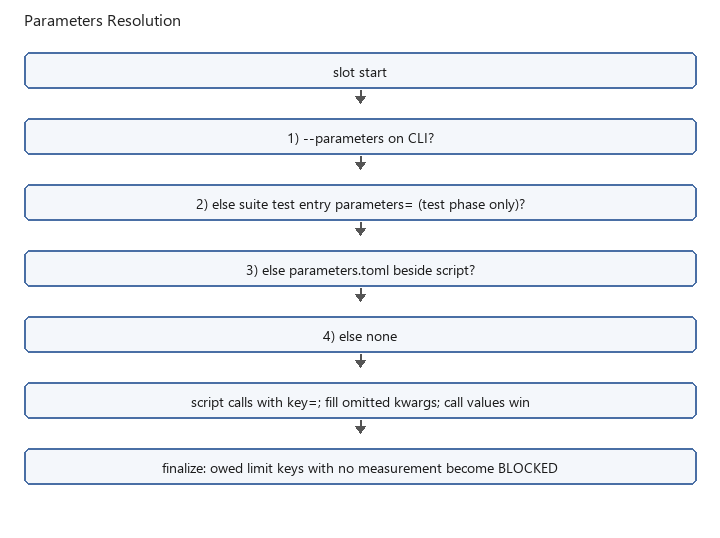

Using parameter files
=====================

An optional TOML parameters file supplies kwargs by evidence key. Tables are
keys; values are keyword arguments for ``@command`` and ``@verification`` calls
that pass ``key=``. A field in the file overrides the same argument on the call.
Arguments the file omits stay as passed.

.. list-table:: Parameter file selection
   :header-rows: 1

   * - Source
     - Role
   * - CLI ``--parameters PATH``
     - Suite-level file for the process (overrides the suite TOML path)
   * - Suite TOML ``parameters = "..."``
     - Suite-level file when the CLI flag is omitted
   * - Suite test entry ``parameters``
     - Test-level file for that slot
   * - ``parameters.toml`` beside the script
     - Test-level file when the entry has no ``parameters`` path
   * - None of the above
     - No parameter file

For a single ``colosseum run``, the first present source among CLI, sibling
``parameters.toml``, and none applies; there is no suite TOML. For
``colosseum run-suite``, stacking is the default: each test slot loads the
union of its test-level file and the suite-level file. A shared key is replaced
as a whole table by the suite-level section. ``parameter_stacking = false``
restores one-file selection (suite-level file when set, otherwise the test
file). Setup, between, and teardown slots load only the suite-level file.

When a file is loaded, a ``key=`` with no section keeps the arguments from the
call. A section that is present overrides those arguments. A present but invalid
file fails the slot before ``main``. If a run ends before measuring a key with
configured limits, finalization records the corresponding verification as
``BLOCKED``. Sections that contain ``expected_val``,
``expected_result``, ``tolerance``, ``minimum``, ``maximum``, ``exact``, or
``expected`` define those outstanding checks (called *owed limits*).

**Limit-only parameters file** (``parameters.toml``)::

   [dut_3v3_rail]
   expected_val = 3.3
   tolerance = 0.1

   [rx_level]
   expected_val = 0.0
   tolerance = 0.5

**Script** (limits come from the file via ``key=``)::

   def main() -> None:
       measure_level(key="rx_level", value=0.0)
       verify_level(key="rx_level")  # expected_val / tolerance filled from file

**Suite** (suite-level file stacked onto per-entry files)::

   name = "receiver_limits"
   parameters = "suite_limits.toml"
   tests = [
     { path = "receiver_test.py", parameters = "limits_low.toml" },
     { path = "receiver_test.py", parameters = "limits_high.toml" },
   ]

**Reading one field**

``col.load_parameter(key, field=...)`` returns one value from the loaded
parameters file. The key may be positional or a keyword. A procedure uses it
for a list of paths or another setting the script reads itself. The value is
returned exactly as ``tomllib`` loaded it: strings, ints, floats, and bools as
written, a TOML array as a ``list``, and an inline or nested table as a
``dict``. Nothing is parsed out of strings. A missing key returns ``None``.

**Optional suite override**::

   [example_override]
   example = true

**Script**::

   override = col.load_parameter("example_override", field="example")
   if override:
       ...

**captures.toml**::

   [captures]
   files = ["trace.bin", "C:/data/other.bin"]
   count = 3

**Script**::

   files = col.load_parameter(key="captures", field="files")
   for path in files:
       measure_capture(path)

``files`` is a real ``list`` of strings. Quote every string; a bare word such
as ``trace.bin`` is not valid TOML. A quoted number such as ``"99"`` stays a
string; unquoted ``99`` is an int. ``key=`` calls receive the value as loaded
from TOML.

No parameters file loaded, or a missing field inside a present key, raises
``ParametersError``.

Standard TOML for list, dict, and table fields
----------------------------------------------

Parameters files are standard TOML (see :doc:`configuration`). Use native TOML
containers for fields that hold collections.

**List field** (array)::

   [sweep]
   frequencies_hz = [1000, 2000, 5000]
   labels = ["low", "mid", "high"]

**Dict field** (inline table)::

   [sweep]
   limits = { min = 0.0, max = 5.0 }

**Dict field** (nested table)::

   [sweep.limits]
   min = 0.0
   max = 5.0

**Script**::

   freqs = col.load_parameter("sweep", field="frequencies_hz")   # [1000, 2000, 5000]
   limits = col.load_parameter("sweep", field="limits")          # {"min": 0.0, "max": 5.0}
   high = limits["max"]

Both dict spellings load as the same ``dict``. The same values passed as call
keyword arguments through ``key=`` arrive as ``list`` and ``dict`` objects too.

See ``examples/parameters/`` in the core repository checkout. For ready-made bench procedures,
copy a folder from :doc:`testware_library`.

Resolved-value example
----------------------

Install Shared and use the files from :doc:`quickstart`. Create **tight.toml**::

   [voltage]
   expected_val = 3.5
   tolerance = 0.05

Then run::

   colosseum run my_test.py -g config.toml --parameters tight.toml

The measurement remains 3.3. The verifier uses 3.5 +/- 0.05 from the file,
overriding 3.3 +/- 0.1 on the call, and records FAIL. Change only the file's
``tolerance`` to 0.3 and rerun: the check passes. A file that supplies only
``tolerance`` retains the call's ``expected_val``.

.. list-table:: Effective arguments for the same call
   :header-rows: 1

   * - Parameter section
     - Expected value
     - Tolerance
     - Result for 3.3
   * - None
     - 3.3 (call)
     - 0.1 (call)
     - PASS
   * - ``tight.toml``
     - 3.5 (file)
     - 0.05 (file)
     - FAIL
   * - ``tight.toml`` after editing tolerance
     - 3.5 (file)
     - 0.3 (file)
     - PASS

Commands and verifications receive per-key overrides. Measurement acquisition
arguments are not overridden by this mechanism. Suite stacking merges the suite-level file onto each test file
by default; a single ``colosseum run`` still loads one file.
